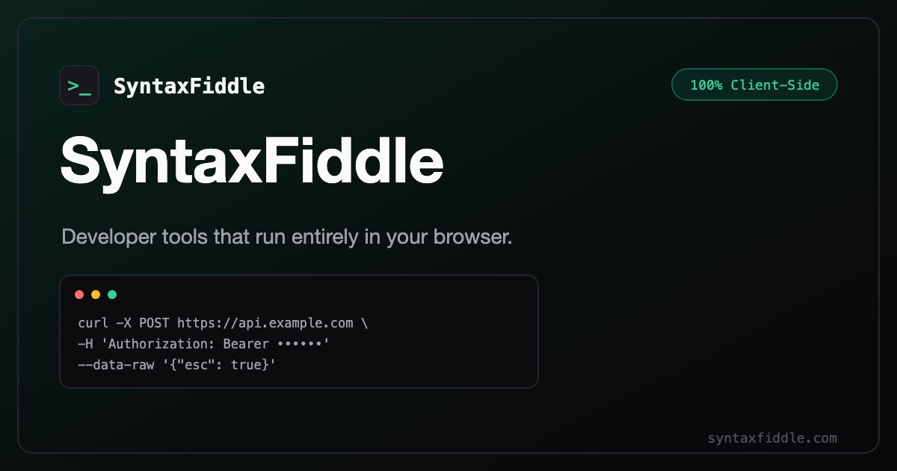

<div align="center">



# SyntaxFiddle

**Free, open-source developer tools that run entirely in your browser.**
No accounts · No servers · No telemetry — 0 bytes of your input ever leave the tab.

[](https://syntaxfiddle.com)
[](https://github.com/nikharminds/SyntaxFiddle/actions/workflows/ci.yml)
[](LICENSE)
[](CONTRIBUTING.md)

**👉 Use the tools at [syntaxfiddle.com](https://syntaxfiddle.com)**

</div>

---

Most web-based developer tools quietly ship your input to a backend: you paste a cron
schedule or a customer CSV, the browser POSTs it to an API, and copies land in logs you
will never audit. SyntaxFiddle eliminates that entire class of risk through architecture —
it is a fully static application where every parser, converter, and simulator executes
inside your browser tab.

You can verify this yourself: open your browser's network panel and watch it after a page
loads. Nothing is ever sent. This makes SyntaxFiddle safe for production crontabs,
customer exports, internal schedules, and live auth tokens.

## Tools

| Tool | What it does |
| --- | --- |
| [Cron Expression Tester & Generator](https://syntaxfiddle.com/cron/) | Parse, explain, and simulate cron schedules across **Unix, Quartz, AWS EventBridge, and Cloudflare** dialects — plain-English translation, run timeline, timezone-aware next runs, and 100+ [ready-made cron recipes](https://syntaxfiddle.com/cron/every-5-minutes/). |
| [Conversion Studio](https://syntaxfiddle.com/csv/) | **20 dedicated converters** across CSV, Excel, JSON, SQL, and XML — [CSV→JSON](https://syntaxfiddle.com/csv-to-json/), [CSV→SQL](https://syntaxfiddle.com/csv-to-sql/), [CSV→SOQL](https://syntaxfiddle.com/csv-to-soql/), [CSV→XML](https://syntaxfiddle.com/csv-to-xml/), [CSV→Markdown](https://syntaxfiddle.com/csv-to-markdown/), [CSV→YAML](https://syntaxfiddle.com/csv-to-yaml/), [Excel→SQL](https://syntaxfiddle.com/excel-to-sql/), [Excel→JSON](https://syntaxfiddle.com/excel-to-json/), [Excel→XML](https://syntaxfiddle.com/excel-to-xml/), [Excel→SOQL](https://syntaxfiddle.com/excel-to-soql/), [Excel→Markdown](https://syntaxfiddle.com/excel-to-markdown/), [Excel→YAML](https://syntaxfiddle.com/excel-to-yaml/), [JSON→CSV](https://syntaxfiddle.com/json-to-csv/), [JSON→Excel](https://syntaxfiddle.com/json-to-excel/), [JSON→YAML](https://syntaxfiddle.com/json-to-yaml/), [SQL→CSV](https://syntaxfiddle.com/sql-to-csv/), [SQL→Excel](https://syntaxfiddle.com/sql-to-excel/), [XML→JSON](https://syntaxfiddle.com/xml-to-json/), [XML→CSV](https://syntaxfiddle.com/xml-to-csv/), and [XML→Excel](https://syntaxfiddle.com/xml-to-excel/) — real typed `.xlsx` output, delimiter sniffing, column type inference, 100% client-side. |
| [cURL Converter](https://syntaxfiddle.com/curl-converter/) | Transpile cURL commands to idiomatic code in **10 targets**: [fetch](https://syntaxfiddle.com/tools/curl-to-javascript-fetch/), [axios](https://syntaxfiddle.com/curl-to-axios/), [Python requests](https://syntaxfiddle.com/tools/curl-to-python-requests/), [PHP](https://syntaxfiddle.com/curl-to-php/), [Go](https://syntaxfiddle.com/curl-to-go/), [C#](https://syntaxfiddle.com/curl-to-csharp/), [Java](https://syntaxfiddle.com/curl-to-java/), [Salesforce Apex](https://syntaxfiddle.com/tools/curl-to-salesforce-apex/), [PowerShell](https://syntaxfiddle.com/curl-to-powershell/), and [HTTPie](https://syntaxfiddle.com/curl-to-httpie/). Headers, JSON bodies, basic auth included. |
| [Regex Tester](https://syntaxfiddle.com/regex-tester/) | Evaluate patterns with live match highlighting, capture groups, and flags — sandboxed in a Web Worker with ReDoS protection. Dialect modes for [MySQL](https://syntaxfiddle.com/regex/mysql/), [Python](https://syntaxfiddle.com/regex/python/), [PHP/PCRE](https://syntaxfiddle.com/regex/php/), [Java](https://syntaxfiddle.com/regex/java/), and [.NET](https://syntaxfiddle.com/regex/dotnet/) translate flavor-specific syntax to JS with per-construct notices — untranslatable constructs are blocked, never silently mis-matched. |
| [JWT Decoder](https://syntaxfiddle.com/jwt-decoder/) | Inspect JSON Web Tokens locally: color-coded segments, syntax-highlighted claims, and expiry checks. Decode-only, zero network calls. |
| [JSON to Schema Converter](https://syntaxfiddle.com/json-to-schema/) | Infer types from raw JSON into [Zod](https://syntaxfiddle.com/tools/json-to-zod/), [TypeScript](https://syntaxfiddle.com/json-to-typescript/), [Pydantic](https://syntaxfiddle.com/tools/json-to-pydantic/), and [Go structs](https://syntaxfiddle.com/json-to-go-struct/). |
| [XML to Schema Converter](https://syntaxfiddle.com/xml-to-schema/) | Same four targets from XML documents — [XML→Zod](https://syntaxfiddle.com/xml-to-zod/), [XML→TypeScript](https://syntaxfiddle.com/xml-to-typescript/), [XML→Pydantic](https://syntaxfiddle.com/xml-to-pydantic/), and [XML→Go structs](https://syntaxfiddle.com/xml-to-go-struct/), with `@attr` conventions, repeated-element arrays, and CDATA preserved. |
| [JSON to Apex Class Generator](https://syntaxfiddle.com/json-to-apex/) | Turn JSON into Salesforce Apex wrapper classes — inner classes for nested objects, `List<>` members for arrays, a `parse()` helper via `JSON.deserialize`, and optional `@AuraEnabled` members. One tool, three modes: a wire-callable `@AuraEnabled(cacheable=true)` parse() for LWC, and a `fromHttpResponse()` callout helper for REST integrations; reserved words mangled, original key casing preserved. |
| [Developer Tools Directory](https://syntaxfiddle.com/tools/) | One-page index of every tool — all 20 converters, the cURL targets, the schema generators, and the Salesforce developer tools. |

## Popular Salesforce tools

[JSON to Apex class generator](https://syntaxfiddle.com/json-to-apex/) ·
[SOQL formatter](https://syntaxfiddle.com/soql-formatter/) ·
[CSV to SOQL IN clauses](https://syntaxfiddle.com/csv-to-soql/) ·
[Excel to SOQL IN clauses](https://syntaxfiddle.com/excel-to-soql/) ·
[cURL to Salesforce Apex](https://syntaxfiddle.com/tools/curl-to-salesforce-apex/)

## Popular conversions

Every direction runs 100% in your browser — paste, convert, copy or download:

[convert JSON to YAML](https://syntaxfiddle.com/json-to-yaml/) ·
[Excel to YAML converter](https://syntaxfiddle.com/excel-to-yaml/) ·
[CSV to YAML](https://syntaxfiddle.com/csv-to-yaml/) ·
[CSV to JSON](https://syntaxfiddle.com/csv-to-json/) ·
[CSV to SQL INSERTs](https://syntaxfiddle.com/csv-to-sql/) ·
[JSON to CSV](https://syntaxfiddle.com/json-to-csv/) ·
[JSON to Excel (.xlsx)](https://syntaxfiddle.com/json-to-excel/) ·
[Excel to SQL](https://syntaxfiddle.com/excel-to-sql/) ·
[XML to JSON](https://syntaxfiddle.com/xml-to-json/) ·
[SQL INSERT to CSV](https://syntaxfiddle.com/sql-to-csv/)

— plus ten more directions in the [Conversion Studio](https://syntaxfiddle.com/csv/).

## Popular cron recipes

Every recipe ships with plain-English explanation, next-run previews, and platform-specific
equivalents (systemd timers, Kubernetes CronJobs, Vercel Cron, Celery beat):

[every minute](https://syntaxfiddle.com/cron/every-minute/) ·
[every 15 minutes](https://syntaxfiddle.com/cron/every-15-minutes/) ·
[every 30 minutes](https://syntaxfiddle.com/cron/every-30-minutes/) ·
[every hour](https://syntaxfiddle.com/cron/every-hour/) ·
[daily at midnight](https://syntaxfiddle.com/cron/daily-at-midnight/) ·
[daily at 9am](https://syntaxfiddle.com/cron/daily-at-9am/) ·
[weekdays at 9am](https://syntaxfiddle.com/cron/weekdays-at-9am/) ·
[every Monday](https://syntaxfiddle.com/cron/every-monday/) ·
[first day of month](https://syntaxfiddle.com/cron/first-day-of-month/) ·
[last day of month](https://syntaxfiddle.com/cron/last-day-of-month/) ·
[weekends at noon](https://syntaxfiddle.com/cron/weekends-at-noon/) ·
[quarterly](https://syntaxfiddle.com/cron/quarterly/)

— plus 120+ more on the [cron recipes hub](https://syntaxfiddle.com/cron/), including
[Quartz](https://syntaxfiddle.com/cron/quartz-every-second/),
[AWS EventBridge](https://syntaxfiddle.com/cron/aws-eventbridge-every-5-minutes/), and
[Cloudflare Cron](https://syntaxfiddle.com/cron/cloudflare-every-hour/) dialect recipes.

## How it works

- **Static export, zero backend** — every page is pre-rendered HTML at build time (`next build` → `./out`), served from any CDN edge. No cold starts, no server round trips, nothing to attack.
- **Deterministic TypeScript engines** — the cron engine (4 dialects), the CSV/Excel/JSON/SQL/XML converter engines, the cURL transpiler, the XML parser, the JSON/XML type-inferrers, and the Apex class generator are hand-written, code-split per route, and covered by **490+ unit tests**.
- **Web Workers for heavy lifting** — regex evaluation and file conversion run off the main thread, with ReDoS protection on pattern input.
- **Privacy by architecture, not by policy** — we cannot log what we never receive.

## Quick start

Requires Node.js 18.18+.

```bash
git clone https://github.com/nikharminds/SyntaxFiddle.git
cd SyntaxFiddle
npm install
npm run dev          # http://localhost:3000
```

```bash
npm run build        # static export to ./out
npm run typecheck    # TypeScript, no emit
npm run test         # vitest unit tests
npm run preview      # serve ./out locally
```

## Self-hosting

The entire site is a static folder — host it anywhere: Cloudflare Pages, GitHub Pages,
Netlify, S3, or your own nginx.

```bash
npm run build
npx serve out        # or deploy ./out to any static host
```

Optional build-time environment variables (both have safe defaults):

| Variable | Purpose |
| --- | --- |
| `NEXT_PUBLIC_SITE_URL` | Canonical site URL (used in sitemap, canonicals, OG tags) |
| `NEXT_PUBLIC_GA_MEASUREMENT_ID` | Google Analytics ID — omit for a fully script-free build |

## Project structure

```
app/           # Next.js App Router — one folder per tool, statically exported
components/    # UI primitives + per-tool components (cron, converter, regex, JWT, ads)
hooks/         # React hooks for tool state
lib/           # Core logic: cron engine & recipes, cURL transpiler, converters, tests
workers/       # Web Workers for heavy parsing
public/        # Static assets, robots.txt, OG images
tests/         # Integration tests
```

## Contributing

Contributions are welcome — especially **new cron dialects** (Salesforce `System.schedule`
is on the [roadmap](https://github.com/nikharminds/SyntaxFiddle/issues)), **new cron
recipes**, and **new conversion targets**. Adding a recipe takes one line of data; the
page, FAQ, schema markup, and sitemap entry are generated automatically.

See [CONTRIBUTING.md](CONTRIBUTING.md) for the guide, and look for
[`good first issue`](https://github.com/nikharminds/SyntaxFiddle/labels/good%20first%20issue)
labels. Hacktoberfest PRs are welcome.

## Security & privacy

All processing happens locally in the browser. No input data, telemetry, or personal
information is transmitted or logged — read the full
[privacy policy](https://syntaxfiddle.com/privacy/) and
[terms of service](https://syntaxfiddle.com/terms/), and
[about the project](https://syntaxfiddle.com/about/). Found a vulnerability? See
[SECURITY.md](SECURITY.md) for responsible disclosure.

## License

Released under the [MIT License](LICENSE).

---

<div align="center">

**If SyntaxFiddle saved you a round-trip to a sketchy server-backed tool, ⭐ star the repo — it helps other developers find it.**

[Use the tools →](https://syntaxfiddle.com)

</div>
